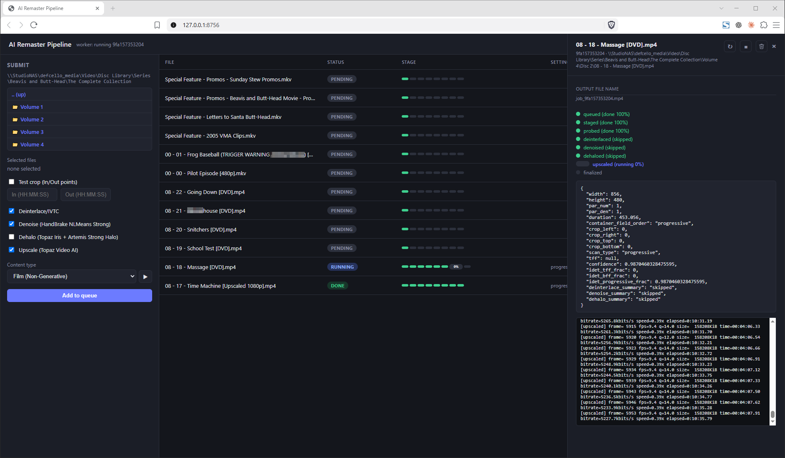

# AI Remaster Pipeline

A local pipeline for AI-upscaling an SD/interlaced video library, following a non-generative
upscaling workflow: **normalize to progressive** → optional **remove noise/grain** → optional **remove blur** →
optional **remove halo** → **AI upscale** → **finalize**. A FastAPI backend runs jobs from a SQLite-backed queue on a background
worker thread; a plain-JS dashboard (no build step) shows live progress over SSE.



The dashboard has two tabs:

- **Library** — browse one or more source roots (NAS shares, local folders), pick a workflow, see
  which files that workflow has already processed, preview each file's output path, and queue the
  selection.
- **Queue** — reorder, pause/resume, abort, rerun or retry jobs, and watch per-stage progress,
  frame/ETA stats and encoder logs update live. **Retry / continue from checkpoint** resumes a
  failed job from its last completed stage (or, for generative upscales, its last saved segment).

## Stages

1. **Normalize to Progressive** — deinterlace/IVTC with Hybrid's bundled QTGMC/VIVTC via VapourSynth
2. **Remove Noise/Grain** — HandBrake NLMeans
3. **Remove Blur** — Topaz Iris (recovers detail in soft/blurry sources)
4. **Remove Halo** — Topaz Artemis Strong Halo (removes ringing/halo artifacts from oversharpened DVD sources)
5. **Upscale to 1080p** — Topaz Video AI, driven headlessly via its bundled ffmpeg

The dashboard's **Show Processing Stack** panel lists each selected stage's purpose and the
tools/settings it will use.

Each stage is independently toggleable, and a content type (Live Action, 2D Graphics,
3D Graphics, Mixed — or Auto-Detect, which classifies each file with a CLIP-based detector) plus an
"Allow Generative Tools" switch picks the tuned settings for that run. With generative tools on,
the upscale runs Topaz's Starlight diffusion models through `neuroserver.exe`. The source is cut into
segments at black frames and each one is checkpointed to disk, so a multi-day job survives a crash,
pause or reboot.

## Workflows and per-folder settings

Any source folder can contain a `.ai-remaster-pipeline.settings.json` that defines named workflows
(stage toggles, content type, crop, temp/milestone/output folders, and an output filename template).
Settings are inherited from parent folders unless a file sets `ignore_parent_settings`. A workflow
defined in a folder is merged over the workflow of the same name from its parents. Templates use
`${...}` variables such as `${dir-source}`, `${workflow-tag}` and `${output-vresmode}`, plus `$1`..`$9`
groups from the base filename regex. The default produces names like `Title [Upscaled 1080p].mkv`.
See the docstring at the top of [app/library.py](app/library.py) for the full syntax. The Library
tab's root folders are stored in `library.json`.

Finished files are always delivered as Matroska, tagged with the source path and the workflow that
produced them. That's how the Library recognizes already-processed files.

## Staging

Each job copies its source to a local staging folder before processing: the workflow's temp
folder if it has room, otherwise the first drive in `config.json`'s `staging_drives` that has room.
Staging on FAT32 is refused because of its 4 GiB file-size limit. Intermediate files are deleted
at each stage boundary once they are no longer needed for a retry. Staging can be a RAM disk, but
it's wiped on reboot, so generative checkpoints go to `checkpoint_root` / the workflow's
milestone folder instead.

## Requirements

- **Windows** with an **[NVIDIA GPU](https://www.nvidia.com/en-us/geforce/drivers/)** — the
  pipeline drives Topaz's bundled ffmpeg using hardware `*_nvenc`/`*_cuvid` codecs exclusively;
  there's no software encode/decode fallback.
- **[Python 3.10+](https://www.python.org/downloads/)**, with `pip install -r requirements.txt`
  (FastAPI/Uvicorn for the server, and open_clip + a CPU build of PyTorch for content-type
  auto-detection — `pip install torch --index-url https://download.pytorch.org/whl/cpu` keeps
  the download small).
- **[Topaz Video AI](https://www.topazlabs.com/topaz-video)**, with an active paid subscription —
  optional; only needed if you enable the Upscale, Remove Blur and/or Remove Halo stages (all use Topaz models, and
  every one of them requires a subscription; there is no perpetual-license tier that unlocks them).
  The pipeline runs fine without Topaz installed as long as those stages stay off.
- **[Hybrid](https://www.selur.de/downloads)** (Selur's VapourSynth-based deinterlacer/encoder
  GUI) — optional; only needed if you enable the Normalize to Progressive stage. Installed for its
  bundled, portable VapourSynth runtime, VSPipe, and QTGMC/VIVTC filter DLLs, which this project
  drives directly so results match what Hybrid's own GUI would produce.
- **[HandBrakeCLI](https://handbrake.fr/downloads2.php)** — optional; only needed if you enable
  the Remove Noise/Grain stage (the pipeline runs fine without it as long as that stage stays off). This is the
  separate command-line download, not the regular HandBrake GUI installer — the GUI app doesn't
  include the `HandBrakeCLI.exe` binary this stage shells out to.

Every stage above is independently toggleable in the dashboard, and its underlying tool is only
touched when that toggle is on — so in principle you only need to install whichever tools back the
stages you actually plan to use.

All tool paths live in `config.json` and are currently hardcoded to one specific Windows machine's
install locations — see "Machine-specific configuration" in [CLAUDE.md](CLAUDE.md) before running
this anywhere else.

## Running it

```bash
pip install -r requirements.txt
python -m app.server          # starts the server at http://127.0.0.1:8756
start_pipeline.bat            # same, plus opens the dashboard in Brave
```

There's no build step. Unit tests cover the library/workflow logic, staging and pre-flight checks:

```bash
python -m unittest discover -s tests
```

Anything touching the actual video tools still needs to be checked by running a short clip through
the dashboard.

## Notes

This is tightly coupled to tool installs on one specific Windows machine. See
[CLAUDE.md](CLAUDE.md) for the full architecture, the job state machine, and a long list of
hard-won gotchas discovered while building this.
